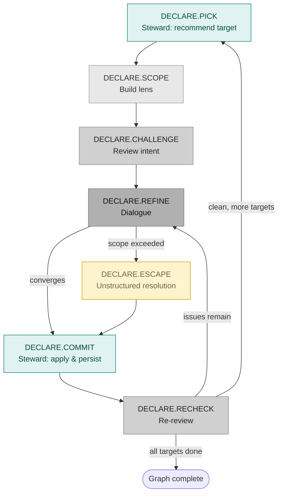

# Workflow: Declare (forward intent creation)

**Status:** Draft
**Direction:** Top-down — human declares intent, agents challenge and refine.
**Output:** A refined IntentGraph (+ ProjectionIG). No code generation — that is a separate workflow.
**ProjectionIG bootstrap:** The project's ProjectionIG is instantiated from `projection/projection_dimensions.ig.yaml` (dimension ontology) with language defaults from `../vscode_extension/intentgraph-vscode/python_defaults.ig.yaml` (or equivalent). The Elicitor walks the human through confirming or overriding each rendering dimension during refinement.
**UID Prefix:** `DECLARE.*` — see [workflow_design_guidelines.md](workflow_design_guidelines.md) for the full step UID scheme.
**Primary agents:** Critic, Elicitor, Navigator, Steward.

---

## Fundamental Operation
<!-- Lines 14-16 -->

One recursive operation applied to a **target node**, repeated until all targets are processed. This is not a multi-phase pipeline — it is a single loop applied to different targets.

## Definitions
<!-- Lines 19-33 -->

**Target:** An intentnode to focus on. The center of the current work.

**Target-adj (1-adjacency):** Everything directly connected to the target:

- The target node itself
- Its direct parent (via treearc)
- Its direct children (via treearc)
- All intentlinks where target is src or dst
- All intentnodes on the other end of those intentlinks

The target-adj is the **scope of possible edits** in one loop iteration. If a problem requires changes outside the target-adj, the loop enters unstructured resolution (`DECLARE.ESCAPE`).

**Target queue:** An ordered list of nodes awaiting their turn as target. Persisted across sessions.

## IV-context Construction (v1)
<!-- Lines 36-57 -->

Given a target T, the Navigator constructs the lens (shaped view) deterministically:

1. **T** — full detail (all fields serialized)
2. **T's children** — full detail
3. **T's parent** — full detail
4. **All intentlinks touching T** — included in the lens's intentlink section
5. **Intentlink neighbor nodes** (nodes on the other end of T's links) — included in the lens node set

The **IV-shape node set** is fixed by this construction:
- `I` (vertical): root orientation through parent/child structure
- `V` (lateral): target-centered neighbors via tree + intentlinks

The **detail mode** is then applied on top of that node set:

- **Full IV-context:** all lens nodes are serialized in full detail.
- **Lean IV-context:** same lens nodes, but only target + direct neighbors are full detail; all others are lean (`uid`, `name`, `intent`, `epistemic_state`).

**Future refinement (v2):** Intentlink-neighbor nodes may also show *their* adjacencies at a progressively coarser level. Deferred — test v1 first.

**Edge case — ROOT as target:** ROOT has no parent, no intentlinks (initially), no children (initially). The lens is just ROOT. The Critic will flag "mandatory fields missing" and "no children — is this the full system?" The Elicitor walks the human through populating ROOT and decomposing it into level-1 children.

## Step UID Table
<!-- Lines 60-70 -->

| UID | Step | Actor | Description |
| --- | --- | --- | --- |
| `DECLARE.PICK` | Pick target | Steward | Recommend next target from queue with structural rationale |
| `DECLARE.SCOPE` | Build lens | Navigator | Construct target-adj IV-context lens (full or lean) |
| `DECLARE.CHALLENGE` | Review intent | Critic | Structured issue list on the lens |
| `DECLARE.REFINE` | Dialogue | Elicitor ↔ Human ↔ Critic | Resolve issues, converge on edits |
| `DECLARE.ESCAPE` | Unstructured resolution | Human + agents | Escape hatch when scope exceeded |
| `DECLARE.COMMIT` | Apply & persist | Steward | Apply edits, audit structure, propagate constraints, reorder queue, persist |
| `DECLARE.RECHECK` | Re-review | Critic | Verify edits resolved the issues |

## Workflow Diagram
<!-- Lines 73-106 -->

---

## Loop Steps (detailed)
<!-- Lines 109-109 -->

### `DECLARE.PICK` — Pick target (Steward)
<!-- Lines 112-118 -->

The Steward recommends the next target from the queue with structural rationale (Mode 3: Target recommendation). The orchestrator presents the recommendation to the human for confirmation.

- If the queue is empty and the graph is empty: Steward recommends ROOT (bootstrap).
- If the queue is empty and the graph exists: Steward recommends pausing.
- Otherwise: Steward analyzes graph topology — data-flow order via intentlinks, dependency density, constraint inheritance freshness, breadth-first bias (prevents lopsided trees). Presents recommendation + rationale + alternatives. **Human confirms or overrides.**

### `DECLARE.SCOPE` — Build lens
<!-- Lines 121-123 -->

Navigator receives the target node UID and the full graph. Produces the target-adj lens per the construction above. This is a deterministic computation, not LLM reasoning (v1).

### `DECLARE.CHALLENGE` — Review intent
<!-- Lines 126-135 -->

Critic receives the lens. Produces a structured issue list. Focus areas:

- Target node: is intent clear? Are constraints complete? Is epistemic_state honest?
- Target's children: do they collectively cover the parent's intent (T4)?
- Intentlinks: are relationships captured? Missing links?
- Intentlink neighbors: are the contracts between target and neighbors clear?

The Critic does not see code — there is no code in this workflow.

### `DECLARE.REFINE` — Dialogue
<!-- Lines 138-148 -->

Elicitor receives the lens + Critic issues. Mediates:

1. Elicitor presents a Critic issue → asks Human for input
2. Human responds
3. Elicitor sends feedback to Critic → Critic refines/proposes changes
4. Elicitor presents proposal to Human → Human accepts/rejects/modifies
5. Loop until convergence on edits + new targets

If the dialogue uncovers problems that cannot be fixed within the target-adj, enter `DECLARE.ESCAPE`.

### `DECLARE.ESCAPE` — Unstructured resolution
<!-- Lines 151-162 -->

When the problem exceeds the target-adj scope, the workflow enters an open mode. The human (with agent assistance) can take arbitrary actions:

- Change the current target
- Reshape the lens (add/remove nodes)
- Edit nodes outside the current target-adj
- Split the problem into multiple targets
- Re-root the discussion at a different level
- Any other action needed

**All actions in this mode are logged** in the workflow trace with `actor: "human"`. When the human exits resolution, the workflow resumes at `DECLARE.COMMIT`.

### `DECLARE.COMMIT` — Apply and persist (Steward)
<!-- Lines 165-175 -->

The Steward agent handles the commit phase — this is not a mechanical system step but a named agent with responsibility for graph integrity:

- Apply edits to the graph (provenance auto-stamps at save; pass `--role` and `-m` on mutating commands)
- Audit structural invariants (treearc is a tree, lens non-overlap, UID uniqueness)
- Propagate constraints to affected neighbors (if edits changed contracts)
- Reorder target queue based on new graph topology
- Save graph to JSON
- Update workflow state (current step UID, processed targets, queue)
- Log the iteration (via `AgentLogger` + workflow trace)

### `DECLARE.RECHECK` — Re-review
<!-- Lines 178-187 -->

After edits are applied, the Critic re-reviews the updated lens for the same target. This is the **self-check**: did the edits actually resolve the issues?

- If the Critic finds remaining issues: loop back to `DECLARE.REFINE` with the new issue list. Same target, another pass.
- If the Critic is satisfied (or the human overrides): proceed to `DECLARE.PICK` for the next target.

This ensures the workflow doesn't move on from a target until it actually passes review.

---

## Termination and Persistence
<!-- Lines 190-199 -->

The workflow **pauses** (not terminates) when:

- The target queue is empty — all queued targets have been processed
- The human says stop

**The queue persists across sessions.** If the human stops mid-workflow and comes back in a new Claude Code session, the workflow state file tells the new session exactly where things stand: which targets are done, which are pending, what the current graph looks like, which step UID was last completed.

Remaining targets in the queue are preserved for future sessions.

## Target Ordering
<!-- Lines 202-207 -->

Default: **breadth-first with data-flow preference.**

- Process all nodes at depth N before going to depth N+1 (prevents lopsided trees)
- Within the same depth, prefer data-flow order: if A→B via intentlink, process A before B
- The Steward applies these heuristics at `DECLARE.PICK` (target recommendation) and `DECLARE.COMMIT` (queue reordering); human can override at any time
