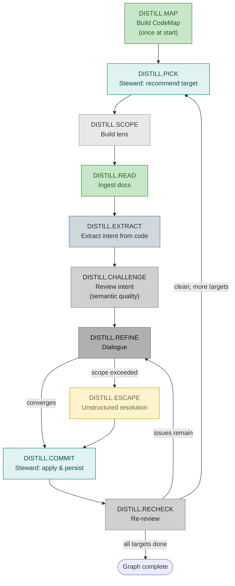

# Workflow: Distill (reverse intent extraction from code)

**Status:** Draft
**Direction:** Bottom-up — Docreader and Extractor distill intent from existing materials, human validates and refines.
**Output:** A refined IntentGraph + ProjectionIG that captures the intent and rendering patterns behind existing code. No code generation — that is a separate workflow.
**UID Prefix:** `DISTILL.*` — see [workflow_design_guidelines.md](workflow_design_guidelines.md) for the full step UID scheme.
**Primary agents:** Docreader, Extractor, Critic, Elicitor, Navigator, Steward.

---

## Relationship to the Declare Workflow
<!-- Lines 13-23 -->

The Distill workflow uses the **same target-based recursive loop** as the [Declare workflow](WORKFLOW_DECLARE.md), with three additions:

1. `DISTILL.MAP` — CodeMap bootstrap before the loop begins
2. `DISTILL.READ` — Docreader ingests documentation before the Critic
3. `DISTILL.EXTRACT` — Extractor grounds/refines intent from code (CodeMap-assisted)

The shared tail of the loop (`*.CHALLENGE` → `*.REFINE` → `*.COMMIT` → `*.RECHECK`) is identical.

The Declare workflow asks the human to provide intent from scratch. The Distill workflow extracts a draft from existing materials (docs, then code), and asks the human to validate and refine it.

## Step UID Table
<!-- Lines 26-39 -->

| UID | Step | Actor | Description |
| --- | --- | --- | --- |
| `DISTILL.MAP` | Build CodeMap | System | `CodeMap.build()` — structural overview (once at start) |
| `DISTILL.PICK` | Pick target | Steward | Recommend next target from queue with structural rationale |
| `DISTILL.SCOPE` | Build lens | Navigator | Construct target-adj IV-context lens (full or lean) |
| `DISTILL.READ` | Ingest docs | Docreader | Propose intent from documentation |
| `DISTILL.EXTRACT` | Extract intent | Extractor | Ground/refine intent from code (CodeMap-assisted) |
| `DISTILL.CHALLENGE` | Review intent | Critic | Structured issue list (semantic quality + projection separation) |
| `DISTILL.REFINE` | Dialogue | Elicitor ↔ Human ↔ Critic | Resolve issues, converge on edits |
| `DISTILL.ESCAPE` | Unstructured resolution | Human + agents | Escape hatch |
| `DISTILL.COMMIT` | Apply & persist | Steward | Apply edits (product IG + PIG uniformly), audit structure, propagate constraints, reorder queue, persist |
| `DISTILL.RECHECK` | Re-review | Critic | Verify edits resolved the issues |

## Workflow Diagram
<!-- Lines 42-88 -->



---

## `DISTILL.MAP` — Build CodeMap + observe architecture-level rendering patterns
<!-- Lines 91-115 -->

Before the target-based loop begins, build a CodeMap of the existing codebase:

```text
CodeMap.build(project_path) → structural overview YAML
```

This structural overview is passed as context to agents throughout the workflow. The Extractor uses it for orientation (see "CodeMap-Assisted Extraction" in the Extractor agent).

**ProjectionIG bootstrap:** The project's ProjectionIG is instantiated from `projection/projection_dimensions.ig.yaml` — the dimension ontology that defines which rendering concerns must be addressed. For Python projects, `../vscode_extension/intentgraph-vscode/python_defaults.ig.yaml` provides opinionated starting values. All dimension nodes start as `undecided` (or as the language default) and are refined to `observed` as the Extractor encounters actual patterns.

**ProjectionIG — architecture level:** The CodeMap structural overview reveals high-level rendering patterns that should be captured as broad ProjectionIG nodes:

- **Package layout** — flat vs nested, monorepo vs multi-package, how modules are grouped
- **Module granularity** — large monolithic modules vs small focused ones, typical LOC per file
- **Type balance** — class-heavy (OOP) vs function-heavy (functional) vs mixed
- **Import patterns** — star imports, lazy imports, re-export conventions
- **Test layout** — tests alongside code vs separate test directory, naming conventions

These observations become **top-level ProjectionIG nodes** (`PIG-<TAG>.` prefix) with `epistemic_state: "observed"` — they describe what the codebase currently does, not necessarily what it *should* do. The human reviews and confirms or overrides during `DISTILL.REFINE`.

If the `codemap` package is not installed, the workflow proceeds without structural context — agents fall back to reading source code directly. The trace records `DISTILL.MAP` with `result: "skipped — codemap not installed"`.

---

## Loop Steps
<!-- Lines 118-118 -->

### `DISTILL.PICK` — Pick target (Steward)
<!-- Lines 121-123 -->

Identical to `DECLARE.PICK` — Steward recommends the next target (Mode 3). See the [Declare workflow](WORKFLOW_DECLARE.md#declarepick--pick-target-steward).

### `DISTILL.SCOPE` — Build lens
<!-- Lines 126-128 -->

Identical to `DECLARE.SCOPE`. See the [Declare workflow](WORKFLOW_DECLARE.md#declarescope--build-lens).

### `DISTILL.READ` — Ingest docs
<!-- Lines 131-140 -->

Docreader discovers and reads documentation relevant to the current target:

1. **Manifest first.** The Docreader runs `md-doc-tree-rich` on the target repo's doc directory. This produces a structured index of markdown files — titles, line counts, section counts — filtered to `.md` files only. The manifest prevents the Docreader from being overwhelmed by non-documentation files.
2. **Select from manifest.** Using the manifest and the current target's context, the Docreader selects which docs are relevant to this target (by title, path proximity, section headings).
3. **Read selected docs.** The Docreader reads the selected files and extracts intent from prose.
4. **Propose edits.** Proposes: intent, constraints, epistemic_state, design_notes — all derived from prose, not code. Distinguishes between intent statements ("the system shall..."), constraints ("must not exceed..."), and implementation notes ("currently implemented as..."). Implementation notes are discarded or marked as informational. Vague documentation → `epistemic_state: "undecided"` (the uncertainty is real).

If the manifest is empty (no markdown docs found), the Docreader step is a no-op and the Extractor works from code alone. The trace records `DISTILL.READ` with `result: "no docs found — skipped"`.

### `DISTILL.EXTRACT` — Extract intent + observe rendering patterns
<!-- Lines 143-164 -->

Extractor reads the actual code for the current target and produces **two outputs**: product intent edits (for the IntentGraph) and PIG edits (same YAML format as product edits, targeting `PIG-*` UIDs).

**Product intent extraction:**

- If CodeMap is available: receives the `overview()` YAML and `context()` IV-context for the target's code area. Uses structural edges (`~calls`, `~inherits`) as intentlink candidates.
- Reads code files mapped to this subtree (via `impl_pointers`, imports, or module structure)
- Grounds/refines what Docreader proposed: confirms intent from code behavior, adds constraints from assertions/guards/type hints, extracts intentlinks from call graphs and data flow
- Sets `impl_pointers` (list of pointer strings: `path[::Symbol[.member]][ (lines X-Y)]`) on the target and proposed children
- Marks epistemic states: code with clear behavior → `known`; implicit behavior → `risky`; unclear purpose → `undecided`
- If tests exist for this code, extracts constraints from test assertions

**ProjectionIG — module level:** While reading code, the Extractor produces PIG edits in the same YAML format as product edits, targeting `PIG-*` UIDs. These cover fine-grained rendering patterns:

- **Naming conventions** — snake_case/camelCase, prefix/suffix patterns, abbreviation habits
- **Error handling** — exception hierarchy, error propagation style, logging patterns
- **Documentation** — docstring style (Google/NumPy/Sphinx), comment density, type annotation coverage
- **Paradigm choices** — this specific module's balance of classes vs functions, use of decorators, metaprogramming
- **API design** — public/private boundary conventions, return type patterns, parameter validation style

These become **child ProjectionIG nodes** under the architecture-level nodes from `DISTILL.MAP`, with `epistemic_state: "observed"`. The Steward applies both product and PIG edits uniformly in the COMMIT step. The Critic's `projection_hints` issue type catches any rendering content that accidentally ends up in the product graph and routes it to the ProjectionIG instead.

### `DISTILL.CHALLENGE` — Review both graphs
<!-- Lines 167-175 -->

The Critic reviews **both** the product lens and the PIG edits proposed by the Extractor. **No source code, no raw documentation** — both are already captured in the lens. Three concerns beyond the standard Declare review:

1. **Internal consistency:** When the Docreader's draft and the Extractor's grounding disagree (visible in `design_notes` and history entries), the Critic flags the inconsistency for the Elicitor to resolve with the human.

2. **Product ↔ projection separation (language-swap test):** The Critic applies the language-swap test to every constraint and intent sentence. If it would break under a different projection (e.g., C++ instead of Python), flag as `projection_hints`.

3. **ProjectionIG quality:** The Critic reviews the Extractor's rendering observations — are they well-formed? At the right granularity? Honest epistemic states? Issues use `pig_quality`, `pig_granularity`, `pig_missing` types.

### `DISTILL.REFINE` — Dialogue on both graphs
<!-- Lines 178-182 -->

The Elicitor works on **both** graphs in the same session. Product intent issues produce edits to the product lens. Projection issues (`projection_hints`, `pig_*`) produce edits to the ProjectionIG. When resolving a projection leak, the Elicitor rewrites the product constraint to be projection-agnostic *and* relocates the projection-specific content to the ProjectionIG.

Otherwise identical to `DECLARE.REFINE`. See the [Declare workflow](WORKFLOW_DECLARE.md#declarerefine--dialogue).

### `DISTILL.RECHECK`
<!-- Lines 185-189 -->

Identical to `DECLARE.RECHECK`. The Critic re-reviews both graphs after edits.

---

## What Each Agent Sees
<!-- Lines 192-216 -->

**Docreader** receives:

- The target node (which may be empty or skeletal)
- The target-adj lens (for context on where this node fits)
- The target repo path (to run `md-doc-tree-rich` on)

The Docreader discovers relevant docs itself: it runs `md-doc-tree-rich` to get a filtered index of markdown files, then selects and reads the ones relevant to the current target. It does not receive pre-selected doc files.

**Extractor** receives:

- The target node as enriched by Docreader (may have draft intent, constraints from prose)
- The target-adj lens
- CodeMap overview and IV-context (when available)
- The actual code files that implement this target's scope (based on `impl_pointers` if available, or code-structure heuristics)
- Test files relevant to this scope (for constraint extraction)

**Critic** receives:

- The lens with both Docreader and Extractor contributions (including `design_notes` and history entries that surface doc ↔ code discrepancies)
- The PIG edits from the Extractor (to validate product ↔ projection separation)
- **No source code, no raw documentation.** The Docreader's findings are baked into the lens (intent, constraints, provenance in `design_notes`). The Extractor's code-derived findings are captured in `design_notes`, `impl_pointers`, and history entries. The Critic reviews the semantic quality of the lens itself.

---

## Bootstrap (First Invocation)
<!-- Lines 219-228 -->

1. `DISTILL.MAP` — Build CodeMap of the project + observe architecture-level rendering patterns → initial ProjectionIG skeleton
2. `DISTILL.PICK` — Steward recommends ROOT (bootstrap: empty graph)
3. `DISTILL.READ` — Docreader reads the project's top-level README → proposes ROOT intent, constraints, epistemic_state
4. `DISTILL.EXTRACT` — Extractor reads the project structure (file tree, entry points, `__init__.py` exports) → proposes ROOT children as level-1 subtrees + produces PIG edits for module-level rendering patterns
5. `DISTILL.CHALLENGE` → `DISTILL.REFINE` → `DISTILL.COMMIT`
6. Level-1 children are queued as targets

This is the same loop — ROOT is just another target. The Docreader happens to read the top-level README, and the Extractor happens to look at the project structure rather than module code. The ProjectionIG grows alongside the product IntentGraph — each iteration may add or refine ProjectionIG nodes as new rendering patterns are observed.

## Target Ordering
<!-- Lines 231-233 -->

Same as Declare: the Steward applies breadth-first with data-flow preference at `DISTILL.PICK` and `DISTILL.COMMIT`. Additionally, the Extractor's code-structure analysis may suggest a natural ordering (e.g., base modules before dependent modules) — the Steward incorporates this when it has visibility into `impl_pointers` (which now lists pointer strings: `path[::Symbol][ (lines X-Y)]`) and CodeMap structure.

## When Docs and Code Disagree
<!-- Lines 236-246 -->

This is expected and valuable. Discrepancies are surfaced by the Docreader and Extractor *into the lens* (via `design_notes` and history entries), then reviewed by the Critic as internal inconsistencies.

| Situation | What happens |
| --- | --- |
| Doc says X, code does X + Y | Extractor records the gap in `design_notes`. Critic flags the unresolved discrepancy. Elicitor asks human: is Y intentional? |
| Doc says X, code does Z | Extractor records the contradiction in `design_notes`. Critic flags the inconsistency. Elicitor asks human: which is correct? |
| Doc exists, code doesn't | Docreader proposes intent; Extractor finds no implementation. Node gets `epistemic_state: "deferred"` |
| Code exists, no doc | Extractor proposes intent from code alone. Epistemic state is lower confidence (`speculative` or `undecided`) |

These discrepancies are exactly what the IntentGraph is designed to surface. The graph makes them explicit rather than letting them hide as they do in a codebase.
