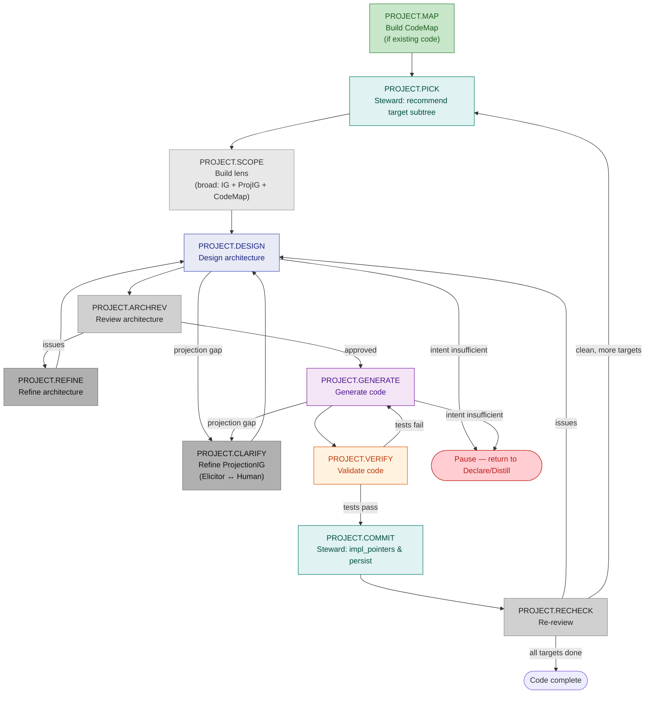

# Workflow: Project (intent → code)

**Status:** Draft
**Direction:** Forward — transforms a refined IntentGraph + ProjectionIG into code.
**Output:** Code on disk + `impl_pointers` set on the IntentGraph. The graph itself is not modified (intent is already settled).
**UID Prefix:** `PROJECT.*` — see [workflow_design_guidelines.md](workflow_design_guidelines.md) for the full step UID scheme.
**Primary agents:** Designer, Generator, Verifier, Critic, Elicitor, Navigator, Steward.

---

## Relationship to Declare and Distill
<!-- Lines 13-19 -->

Declare and Distill are **graph-building workflows** — they produce a refined IntentGraph + ProjectionIG. The Project workflow **consumes** that output: it takes a settled graph and projects it into code.

The Project workflow does not modify **product intent**. If code generation reveals that product intent is insufficient (e.g., a node is too vague to generate from), the workflow pauses and hands back to Declare or Distill.

However, the Project workflow **does refine the ProjectionIG** — rendering decisions (paradigm choice, module granularity, error handling style) are naturally surfaced during architecture design and code generation. When the Designer or Generator encounters a rendering uncertainty not covered by the ProjectionIG, the workflow enters `PROJECT.CLARIFY` — a dialogue with the human that produces new or refined ProjectionIG nodes. This keeps projection-level decisions where they belong: in the code-producing workflow, not in the graph-building workflows.

## Prerequisites
<!-- Lines 22-26 -->

- A product IntentGraph with targets at sufficient depth (leaf nodes have clear intent + constraints)
- A ProjectionIG with rendering preferences, structured per `projection/projection_dimensions.ig.yaml` (dimension ontology). Typically bootstrapped from language defaults (e.g., `../vscode_extension/intentgraph-vscode/python_defaults.ig.yaml`) and refined during Declare/Distill.
- (Optional) An existing codebase via CodeMap — when generating code that must integrate with existing code

## Step UID Table
<!-- Lines 29-43 -->

| UID | Step | Actor | Description |
| --- | --- | --- | --- |
| `PROJECT.MAP` | Build CodeMap | System | `CodeMap.build()` on existing codebase (if any). Skipped for greenfield. |
| `PROJECT.PICK` | Pick target | Steward | Recommend next target subtree for code generation with structural rationale |
| `PROJECT.SCOPE` | Build lens | Navigator | Broader view: target subtree + intentlink neighbors + ProjectionIG + CodeMap context |
| `PROJECT.DESIGN` | Design architecture | Designer | Produce PIG-ARCH.* nodes + Target CodeMap YAML |
| `PROJECT.CLARIFY` | Refine ProjectionIG | Elicitor ↔ Human | Resolve rendering uncertainty — refine ProjectionIG nodes |
| `PROJECT.ARCHREV` | Review architecture | Critic | Architecture-specific issue review (cohesion, completeness, CodeMap divergence) |
| `PROJECT.REFINE` | Refine architecture | Elicitor ↔ Human ↔ Critic | Resolve architecture issues |
| `PROJECT.GENERATE` | Generate code | Generator | Fill Target CodeMap skeleton with implementation |
| `PROJECT.VERIFY` | Validate code | Verifier | Run intent-derived tests against generated code |
| `PROJECT.COMMIT` | Apply & persist | Steward | Set `impl_pointers` (pointer strings: `path[::Symbol][ (lines X-Y)]`), audit structure, persist PIG updates from CLARIFY, save graph, log trace |
| `PROJECT.RECHECK` | Re-review | Critic | Verify generated code satisfies intent + constraints |

## Workflow Diagram
<!-- Lines 46-103 -->



---

## Loop Steps (detailed)
<!-- Lines 106-106 -->

### `PROJECT.MAP` — Build CodeMap (bootstrap)
<!-- Lines 109-119 -->

If the target is an existing codebase (incremental generation or regeneration), build a CodeMap:

```text
CodeMap.build(project_path) → structural overview YAML
```

The Designer uses this to produce architecture that respects or deliberately diverges from existing module boundaries. The Generator uses it to identify integration points.

For greenfield projects (no existing code), this step is skipped. The trace records `PROJECT.MAP` with `result: "greenfield — no existing code"`.

### `PROJECT.PICK` — Pick target subtree (Steward)
<!-- Lines 122-126 -->

The Steward recommends the next target subtree for code generation (Mode 3: Target recommendation). Unlike Declare/Distill (which process one node at a time), the Project workflow may operate on a **subtree** — a node and its descendants — because code generation naturally spans multiple related intentnodes.

The Steward considers: depth-first within subtrees (generate children before integrating parent), breadth-first across subtrees, data-flow order via intentlinks, and `impl_pointers` coverage (subtrees with no generated code yet take priority). **Human confirms or overrides.**

### `PROJECT.SCOPE` — Build lens (broader view)
<!-- Lines 129-142 -->

The Navigator constructs a **broader lens** than in Declare/Distill. The Designer needs enough context to make coherent architecture decisions:

1. **Target subtree** — full detail (all nodes in the subtree being generated)
2. **Intentlink neighbors** — collapsed but present (the Designer needs to see what the target connects to)
3. **ProjectionIG lens** — the rendering preferences relevant to this target
4. **CodeMap overview** (if available) — existing code structure for integration awareness
5. **Root context** — path from root to target for orientation

This uses the same IV-shaped node-set principle as Declare/Distill, but over a wider scope. Mode is selectable:

- **Full IV-context:** all scoped nodes full detail.
- **Lean IV-context:** same scoped nodes, with only target + direct neighbors full detail.

### `PROJECT.DESIGN` — Design architecture
<!-- Lines 145-156 -->

Designer receives the broad lens and produces:

- **PIG-ARCH.* nodes** — architectural decisions with reasoning (module boundaries, type design, interface contracts)
- **Target CodeMap YAML** — the concrete structural plan in CodeMap format

The Designer sees enough of the IG + ProjectionIG + CodeMap to make decisions that are coherent across module boundaries — not just local to one node.

If the Designer determines that **product intent** is insufficient (e.g., `epistemic_state: "undecided"` on a critical node), the workflow pauses and returns to Declare/Distill.

If the Designer encounters a **projection gap** — a rendering decision not covered by the ProjectionIG — the workflow enters `PROJECT.CLARIFY`.

### `PROJECT.CLARIFY` — Refine ProjectionIG
<!-- Lines 159-170 -->

When the Designer or Generator encounters a rendering uncertainty, the Elicitor mediates a dialogue with the human to resolve it. Examples:

- "Should this module use OOP or functional style?" (paradigm not specified in ProjectionIG)
- "The ProjectionIG says 'functional-first' but this entity has genuine state — override to class?" (conflict between directive and reality)
- "What error handling pattern for external API calls?" (not covered by current ProjectionIG)
- "Should generated code include type stubs for downstream consumers?" (documentation/packaging decision)

The outcome is one or more **new or refined ProjectionIG nodes** — added to the ProjectionIG graph with proper `PIG-` UID prefix. These become durable decisions, not ad-hoc choices: they persist in the ProjectionIG and apply to future targets too.

The Elicitor proposes the ProjectionIG edit; the human approves. The workflow then returns to the step that triggered the clarification (typically `PROJECT.DESIGN` or `PROJECT.GENERATE`).

### `PROJECT.ARCHREV` — Review architecture
<!-- Lines 173-181 -->

Critic reviews the Designer's output:

- `structural_cohesion` — module boundaries align with intentlink topology?
- `interface_completeness` — every intentlink has a corresponding interface in the Target CodeMap?
- `codemap_divergence` — divergence from existing codebase structure is justified?

If issues are found, the workflow loops through `PROJECT.REFINE` → `PROJECT.DESIGN`.

### `PROJECT.REFINE` — Refine architecture
<!-- Lines 184-186 -->

Elicitor mediates between Critic issues and the human. The human approves, rejects, or modifies the Designer's architectural decisions. The Designer then revises.

### `PROJECT.GENERATE` — Generate code
<!-- Lines 189-197 -->

Generator receives:
- Approved product lens (what to build)
- ProjectionIG lens including PIG-ARCH.* nodes (how to build it)
- Target CodeMap YAML (the structural plan to follow)
- (Optional) CodeMap overview of existing code (integration context)

Generator follows the structural plan, filling the skeleton with implementation. It does not redesign the architecture — if the plan is insufficient, it flags the gap.

### `PROJECT.VERIFY` — Validate code
<!-- Lines 200-208 -->

Verifier runs intent-derived tests against the generated code:

- E2E tests at the public API level (primary)
- Constraint satisfaction checks (does the code respect every constraint in the product graph?)
- ProjectionIG adherence (does the code follow naming, error handling, documentation conventions?)

If tests fail, the workflow loops back to `PROJECT.GENERATE` for a revision pass. If the failure reveals a deeper issue (missing intent, wrong architecture), it escalates to `PROJECT.DESIGN` or pauses for intent refinement.

### `PROJECT.COMMIT` — Apply and persist (Steward)
<!-- Lines 211-221 -->

The Steward agent handles the commit phase — this is not a mechanical system step but a named agent with responsibility for graph integrity:

- Set `impl_pointers` on every intentnode that was generated for
- Audit structural invariants (treearc is a tree, lens non-overlap, UID uniqueness)
- Persist PIG updates from `PROJECT.CLARIFY` (new or refined ProjectionIG nodes)
- Propagate constraints to affected neighbors (if edits changed contracts)
- Save the updated graph to JSON
- Update workflow state
- Log to the workflow trace

### `PROJECT.RECHECK` — Re-review
<!-- Lines 224-234 -->

Critic reviews the generated code against the product intent as a final check:

- Does the code match the Target CodeMap structure?
- Are all constraints satisfied?
- Are `impl_pointers` correctly set?

If issues remain, loop back to `PROJECT.DESIGN`. If clean, proceed to `PROJECT.PICK` for the next target.

---

## Termination and Persistence
<!-- Lines 237-245 -->

The workflow **pauses** (not terminates) when:

- The target queue is empty — all target subtrees have code generated
- The human says stop
- Intent is insufficient — the workflow hands back to Declare/Distill

The state persists across sessions, same as Declare/Distill.

## Target Ordering
<!-- Lines 248-254 -->

Default: **depth-first within subtrees, breadth-first across subtrees.**

- Within a subtree: generate leaf nodes first, then integrate at the parent level
- Across subtrees: follow data-flow order (if A→B via intentlink, generate A before B)
- The Steward applies these heuristics at `PROJECT.PICK` (target recommendation) and `PROJECT.COMMIT` (queue reordering); human can override at any time

## When the Workflow Needs Input
<!-- Lines 257-259 -->

Two distinct types of gaps can surface during code generation:

### Product intent gaps → pause and return to Declare/Distill
<!-- Lines 262-268 -->

| Situation | What happens |
| --- | --- |
| Node has `epistemic_state: "undecided"` | Designer flags it. Workflow pauses → return to Declare/Distill |
| Node has no constraints | Generator cannot satisfy what isn't specified. Workflow pauses → return to Declare/Distill |
| Intentlink is vague | Designer cannot derive an interface. Workflow pauses → return to Declare/Distill |

### Projection gaps → `PROJECT.CLARIFY` (inline refinement)
<!-- Lines 271-279 -->

| Situation | What happens |
| --- | --- |
| Paradigm choice not specified | Designer triggers `PROJECT.CLARIFY` → human decides → new ProjectionIG node |
| Error handling pattern unclear | Generator triggers `PROJECT.CLARIFY` → human decides → new ProjectionIG node |
| ProjectionIG directive conflicts with target reality | `PROJECT.CLARIFY` → human resolves → refined ProjectionIG node |
| Architecture conflicts with existing code | Critic flags `codemap_divergence` → `PROJECT.REFINE` resolves with human |

The key distinction: product intent gaps require leaving the Project workflow (the product graph is not this workflow's concern). Projection gaps are resolved **within** the Project workflow — they are rendering decisions that naturally surface during code production.
