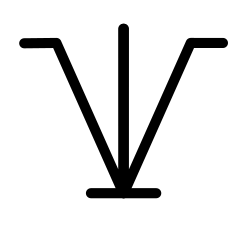

# IntentGraph Logo



## What It Represents

The logo encodes the **IV-shaped context principle**:

> Keep the same lens nodes, but vary detail by distance from the target.

`I` = vertical lineage (root-to-target orientation).  
`V` = lateral neighborhood around the target (parent/children/link-neighbors).

This keeps local reasoning rich while controlling context weight.

## Anatomy

```
  ___              ___
      \     |     /
       \    |    /
        \   |   /
         \  |  /
          \ | /
           \|/
          _____
```

- **The V** — detail gradient on lateral context.
- **Horizontal stubs** — target neighborhood (parent/children/intentlink neighbors).
- **Center vertical** — root-to-target orientation path.
- **Ground bar** — the convergence point. Where intent becomes concrete output.

The left half is an exact mirror of the right half. The shape is constructed by mirroring one path group with `matrix(-1,0,0,1,...)`.

## IV-context Modes

Two serialization modes use the same lens nodes:

- **Full IV-context**: all nodes are serialized with full node detail.
- **Lean IV-context**: same node set, but only target + direct neighbors are full detail.  
  All other nodes are lean: `uid` + `name` (title) + `intent` + `epistemic_state`.

## Files

| File | Format | Use |
|------|--------|-----|
| `logo.svg` | Vector (Inkscape) | Source of truth. Editable. |
| `logo.png` | Raster | For docs, GitHub, embeds. |
