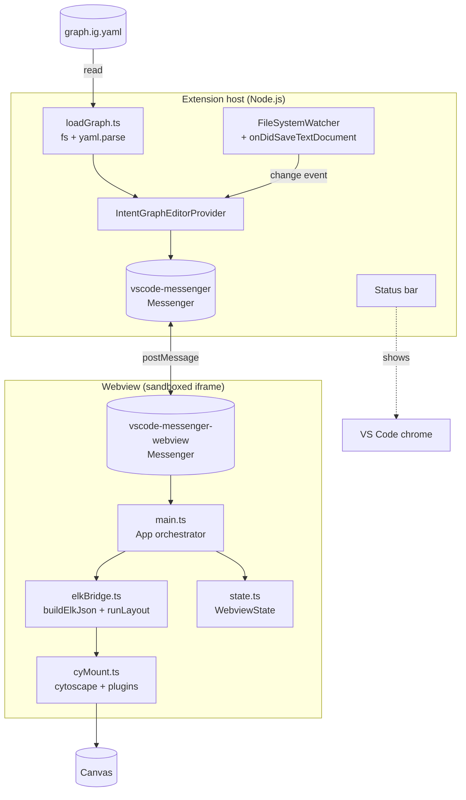
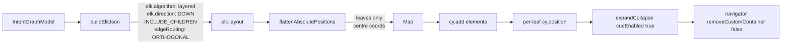
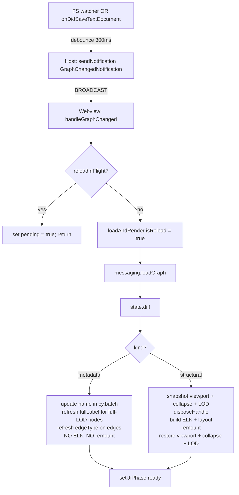

# 2 — Architecture

How the system is put together. Rough-to-fine: macro pipeline, then per-process layout, then per-module responsibilities, then the key invariants and design decisions that hold it all up.

## Table of Contents

1. [Three layers](#three-layers) _(Lines 26-64)_
1. [Data flow](#data-flow) _(Lines 67-99)_
1. [Process boundaries: host vs webview](#process-boundaries-host-vs-webview) _(Lines 102-121)_
1. [Wire protocol](#wire-protocol) _(Lines 124-154)_
1. [Module map](#module-map) _(Lines 157-159)_
   1. [Host modules](#host-modules) _(Lines 162-170)_
   1. [Shared modules](#shared-modules) _(Lines 173-178)_
   1. [Webview modules](#webview-modules) _(Lines 181-194)_
1. [Interaction model](#interaction-model) _(Lines 197-212)_
1. [Layout pipeline](#layout-pipeline) _(Lines 215-240)_
1. [Reload pipeline](#reload-pipeline) _(Lines 243-269)_
1. [Key invariants](#key-invariants) _(Lines 272-287)_
1. [Design decisions and rejected alternatives](#design-decisions-and-rejected-alternatives) _(Lines 290-304)_


---

## Three layers
<!-- Lines 26-64 -->



Three concerns, three owners:
1. **File I/O & lifecycle** — Host. The host owns the disk, the document URI, the watcher, the status bar.
2. **Rendering & interaction** — Webview. The webview owns Cytoscape, ELK layout, the canvas, all gestures.
3. **Wire protocol** — `vscode-messenger`. Bidirectional, typed RPC over `postMessage`.

The webview never reads the disk and never invokes `vscode.*` APIs. The host never holds a Cytoscape instance. The boundary is strict.

---

## Data flow
<!-- Lines 67-99 -->

The full pipeline from "user opens file" to "graph appears":

```mermaid
flowchart LR
  A[User opens *.ig.yaml] --> B[VS Code activates extension<br/>onCustomEditor:intentgraph.graphViewer]
  B --> C[resolveCustomEditor]
  C --> D[panel.webview.html = renderHtml]
  C --> E[messenger.registerWebviewPanel<br/>broadcastMethods set]
  D --> F[Webview boots IIFE main.ts]
  F --> G[messenger.start]
  G --> H[messaging.loadGraph request]
  H --> I[Host loadGraph<br/>fs.readFile + yaml.parse]
  I --> J[IntentGraphModel POJO]
  J -->|response| K[Webview rehydrate Maps]
  K --> L[buildElkJson]
  L --> M[elk.layout]
  M --> N[flattenAbsolutePositions]
  N --> O[mount: cy.add + positions + plugins]
  O --> P[setUiPhase ready]
```



Key shapes flowing through:
- **Raw YAML/JSON** → parsed to `RawGraph` (host-only structural type).
- **`IntentGraphModel`** (in-memory typed model with Maps): `nodes`, `links`, `tree`, plus computed indices `childrenOf`, `parentOf`, `depthOf`. Defined in `src/shared/graphTypes.ts`.
- **`SerialisedIntentGraphModel`** — the wire format. Same data, Maps replaced with plain objects so it survives `postMessage` structured cloning.
- **ELK JSON** — built only in the webview. Compounds get `children: [...]` (from treearcs); intentlinks become root-level `edges`. ELK reassigns containment by lowest common ancestor.
- **Cytoscape elements** — `{ data: { id, name, parent, lod, fullLabel, ... } }` for nodes, `{ data: { id, source, target, edgeType } }` for edges.

The host never touches ELK or Cytoscape. The webview never touches `vscode.*`.

---

## Process boundaries: host vs webview
<!-- Lines 102-121 -->

| Concern | Host | Webview |
| --- | --- | --- |
| File system | ✅ | — |
| `vscode.*` API | ✅ | — |
| `child_process` (ig-tool ping) | ✅ | — |
| YAML parsing (eemeli yaml) | ✅ | — (only consumes parsed POJO) |
| Cytoscape rendering | — | ✅ |
| ELK layout | — | ✅ |
| Tap, drag, zoom handlers | — | ✅ |
| LOD state | — | ✅ |
| Collapse state | — | ✅ (managed by `cytoscape-expand-collapse`) |
| Viewport (zoom/pan) | — | ✅ |
| Status bar | ✅ | — |
| `acquireVsCodeApi()` | — | ✅ (called once in `messaging.ts`) |

CSP: the webview is locked down with `default-src 'none'`, nonce-based `script-src`, scoped `localResourceRoots`. The webview cannot fetch from the network, cannot execute inline scripts, cannot load arbitrary local files.

---

## Wire protocol
<!-- Lines 124-154 -->

All cross-process traffic flows through `vscode-messenger@0.6`. Three message types are defined in `src/messaging/messageTypes.ts`:

| Type | Direction | Shape | Used for |
| --- | --- | --- | --- |
| `PingRequestType` | Webview → Host | `void → PingResponse` | One-shot smoke test on activation; confirms `ig-tool` is reachable. |
| `LoadGraphRequestType` | Webview → Host | `void → LoadGraphResponse` | Initial load; webview asks the host for the parsed model. |
| `GraphChangedNotification` | Host → Webview | `void` | Host fires this after a watched file change. Webview responds by sending another `LoadGraphRequest`. |
| `FitNotification` | Host → Webview | `void` | Status bar click → `cy.fit()` on the webview side. |

The `loadGraph` round trip is request/response. The two notifications are fire-and-forget.

**Critical wiring detail:** `vscode-messenger@0.6` gates broadcast notifications behind a `broadcastMethods` allowlist. If you add a new notification you must list its method name in the `registerWebviewPanel` options:

```ts
// IntentGraphEditorProvider.ts
const participant = messenger.registerWebviewPanel(panel, {
  broadcastMethods: [
    GraphChangedNotification.method,
    FitNotification.method
    // YOUR_NEW_NOTIFICATION.method
  ]
});
```

Notifications addressed to a specific `WebviewIdMessageParticipant` work without `broadcastMethods` in theory, but during debugging we saw silent drops on that path. `BROADCAST` + `broadcastMethods` is the proven pattern.

`onDidSaveTextDocument` is a **second**, parallel reload trigger to the FS watcher — it fires on saves from any VS Code editor instance and is robust to filesystem-watcher flakiness.

---

## Module map
<!-- Lines 157-159 -->

`src/` is partitioned by process boundary: anything in `src/webview/*` lives inside the webview iframe; everything else runs in the extension host. `src/shared/*` is imported by both.

### Host modules
<!-- Lines 162-170 -->

| File | Role |
| --- | --- |
| `extension.ts` | `activate()` / `deactivate()`. Wires the editor provider, status bar item, and `intentgraph.fit` command. |
| `editor/IntentGraphEditorProvider.ts` | `vscode.CustomReadonlyEditorProvider`. For each opened file: builds a webview, registers the messenger, hooks the watcher and save event, schedules debounced reloads. Owns the panel registry. |
| `graph/loadGraph.ts` | Reads the file, parses YAML/JSON via `eemeli/yaml`, builds the `IntentGraphModel` with indices, classifies intentlinks via keyword inference. Pure — no `vscode.*` imports beyond `Uri`. |
| `igtool/igToolClient.ts` | `execFile`-based wrapper around `ig-tool`. Used only for the activation ping; not in the hot path. |
| `messaging/messageTypes.ts` | Cross-process message envelope definitions (request types, notification types). Shared between host and webview by import. |

### Shared modules
<!-- Lines 173-178 -->

| File | Role |
| --- | --- |
| `shared/graphTypes.ts` | `IntentGraphModel`, `IntentNode`, `IntentLink`, `Treearc`, `EdgeType`, `Uid`. Plus `SerialisedIntentGraphModel`, `serialiseModel`, `rehydrateModel`, `composeFullLabel`. Both processes import this. |
| `shared/shims.d.ts` | Ambient `declare module` for `cytoscape-expand-collapse` (no published types). |

### Webview modules
<!-- Lines 181-194 -->

| File | Role |
| --- | --- |
| `webview/main.ts` | The `App` class. Orchestrates the init sequence and the reload diff/apply. Holds the only `App` instance. |
| `webview/messaging.ts` | `WebviewMessaging` — typed RPC client wrapping `vscode-messenger-webview`. Single `acquireVsCodeApi()` call. |
| `webview/state.ts` | `WebviewState` — model + viewport + collapse-set + LOD-set, plus `diff()` (structural vs metadata classifier). |
| `webview/elkBridge.ts` | Builds ELK JSON from the model, runs `elk.layout`, recurses the laid-out output to compute absolute leaf positions. |
| `webview/cyMount.ts` | Registers Cytoscape plugins (`expandCollapse`, `navigator`), creates the `cy` instance, adds elements with leaf positions, exports `wireTapLOD`. |
| `webview/styles/cyStyle.ts` | Cytoscape stylesheet — selectors, colors, sizes, the LOD lean/full split. Pure data. |
| `webview/index.html.ts` | Renders the webview HTML with CSP, nonce, `<div id="cy">`, `<div id="cy-navigator">`, `<div id="banner">`, `<div id="spinner">`. |
| `webview/styles.css` | DOM CSS for the overlays — spinner, banner, navigator position, status overlay. (Cytoscape styles are NOT here — Cytoscape composites onto canvas and ignores DOM CSS.) |

---

## Interaction model
<!-- Lines 197-212 -->

Two gestures, two distinct verbs, no overlap:

| Gesture | Hits | Effect |
| --- | --- | --- |
| Click `+`/`−` cue | HTML overlay drawn by `cytoscape-expand-collapse` on top of compound nodes | Toggle collapse state of that compound's subtree. |
| Click node body | Cytoscape canvas, hits the rectangle interior | Toggle `data.lod` between `'lean'` and `'full'` on the tapped node. |

The cues live in a separate canvas/HTML overlay layer, so cue clicks are intercepted by the plugin and never reach the `cy.on('tap', 'node', …)` handler in `cyMount.ts`. This is why we can use the same single tap event for LOD without ambiguity.

LOD toggle is a pure data update inside `cy.batch()`. Cytoscape style selectors `node[lod = "lean"]` and `node[lod = "full"]` drive the visual difference. No relayout, no rebuild — single-frame transition.

The companion `WebviewState.nodeLOD: Map<Uid, 'lean'|'full'>` mirrors the data so we can restore LOD across reloads.

---

## Layout pipeline
<!-- Lines 215-240 -->



Key constraints:
- Every leaf node gets sentinel `width: 160, height: 60`. Without this, ELK collapses children to (0,0).
- Compound parents intentionally omit width/height; ELK derives them from children + padding.
- Per-compound `layoutOptions` stamp `elk.padding` and `elk.spacing.nodeNode` to defeat the elkjs#326 default-spacing pitfall.
- ELK gives positions relative to each parent compound. Cytoscape needs absolute positions on leaves only (compound parents auto-fit). `flattenAbsolutePositions` recurses and accumulates parent offsets, then converts ELK's top-left origin to Cytoscape's centre origin.
- Position is set per-leaf inside `cy.batch()`. Compound parents are never `.position()`-ed.
- After mount, `expandCollapse` is initialised with `cueEnabled: true` (so the `+`/`−` boxes show), `layoutBy: null` (we never re-layout), `fisheye: false` (would clobber our positions), `undoable: false`.
- `cytoscape-navigator` gets `removeCustomContainer: false` — without this, `nav.destroy()` removes `#cy-navigator` from the DOM, breaking subsequent reloads.

An earlier attempt used a depth ≥ 2 default-collapse policy; it left only L1 modules visible and Cytoscape stacked them at one point because none of them had visible children. We dropped the default collapse in a later patch — the user collapses manually.

---

## Reload pipeline
<!-- Lines 243-269 -->



Why two paths:
- Metadata changes are common (text edits) and don't require relayout. Skipping ELK keeps the round-trip under 100 ms even on big graphs.
- Structural changes are rare but invasive. We pay the full layout cost; the snapshot/restore step preserves the user's visual context.

The `reloadInFlight` flag plus a `pending` bit coalesce bursts of save events into at most one extra reload after the current one finishes.

`disposeHandle()` calls `nav.destroy()` and `cy.destroy()`. With `removeCustomContainer: false`, the DOM divs survive and the next mount succeeds.

---

## Key invariants
<!-- Lines 272-287 -->

These hold throughout the codebase. Violations broke things during development; they are documented here so future changes preserve them.

1. **Webview never reads disk.** All graph data flows through `LoadGraphRequestType`. No `fs.*`, no `fetch`, no relative URL loads in the webview bundle.
2. **Host never imports `cytoscape` or `elkjs`.** Verifying: `grep "cytoscape\|elkjs" dist/extension.js` should be empty.
3. **CSP nonce is cryptographic.** `crypto.randomBytes(16).toString('base64')` per render. Never `Math.random()`.
4. **`acquireVsCodeApi()` called once.** Inside `WebviewMessaging` constructor. Calling it twice throws.
5. **Cytoscape positions only on leaves.** Compound parents auto-fit from children. Calling `.position()` on a parent corrupts the bounding box.
6. **`cy.batch()` wraps multi-element mutations.** Style recomputation per element gets expensive fast.
7. **No tippy, no popper, no `var(--vscode-*)` in Cytoscape styles.** Cytoscape's style engine doesn't expand CSS variables — use literal hex.
8. **No `child_process.exec` and no `shell: true`.** All `ig-tool` invocations go through `execFile`.
9. **`broadcastMethods` lists every notification method** the host wants to push. Forgetting an entry silently drops the notification (we found this the hard way).
10. **Editor provider is `CustomReadonlyEditorProvider`, not `CustomTextEditorProvider`.** No edit, no save in MVP.

---

## Design decisions and rejected alternatives
<!-- Lines 290-304 -->

| Decision | Why | Rejected |
| --- | --- | --- |
| Host parses YAML directly, not via `ig-tool query --structure` | `--structure` omits treearcs and L1 keyword UIDs cannot be reconstructed from dot prefixes. Direct parse is also 5–50× faster (no Python cold start). | Routing all graph reads through `ig-tool`. |
| `vscode-messenger` for RPC | Typed, idiomatic for VS Code, supports request/response and notifications cleanly. | Hand-rolled `postMessage` switch statements. |
| In-node LOD, not floating tooltip | Tippy popovers had anchoring drift on pan/zoom (Cytoscape's canvas doesn't expose DOM nodes for popper to lock to). LOD inside the node is geometrically faithful and matches the IntentGraph mental model (a node carries its content). | Tippy + popper. |
| LOD toggle, no relayout | Relayout on every click is jarring and slow. Acceptable overlap on `full` LOD; user toggles back to `lean` to recover. | Per-toggle ELK rerun; per-subtree relayout. |
| Click cue to collapse, click body to LOD | Two distinct verbs, two distinct gestures, no overlap. Matches PRIMER_02 navigation vs inspection split. | Double-click for LOD; modifier keys; right-click menus. |
| `removeCustomContainer: false` on navigator | Default true wipes `#cy-navigator` from the DOM on `destroy()`, so the next mount fails. | Recreating the div on every mount; switching to a different minimap library. |
| Drop initial-collapse policy | Depth ≥ 2 collapse left single L1 compounds visible with no visible children — Cytoscape stacked them at one point. Showing the full ELK layout is more useful at MVP. | Lens-driven default collapse (planned for a future revision). |
| `BROADCAST` + `broadcastMethods` | The participant-targeted send path silently dropped notifications during debugging. Broadcast with explicit method allowlist worked reliably. | Sending to a specific `WebviewIdMessageParticipant`. |
| Direct elkjs, not the `cytoscape-elk` adapter | We need `expand-collapse` to NOT trigger relayout on collapse (`layoutBy: null`); the adapter bakes layout into Cytoscape's lifecycle and conflicts with that. Direct gives us the coordinate accumulation explicitly. | `cy.layout({ name: 'elk' })`. |
| Plain canvas labels | `cytoscape-node-html-label` would give richer rendering but adds another unmaintained extension. May revisit in a future revision. | HTML overlays per node. |

For the package-pin rationale, see [docs/README.md § Pinned stack](README.md#pinned-stack).
