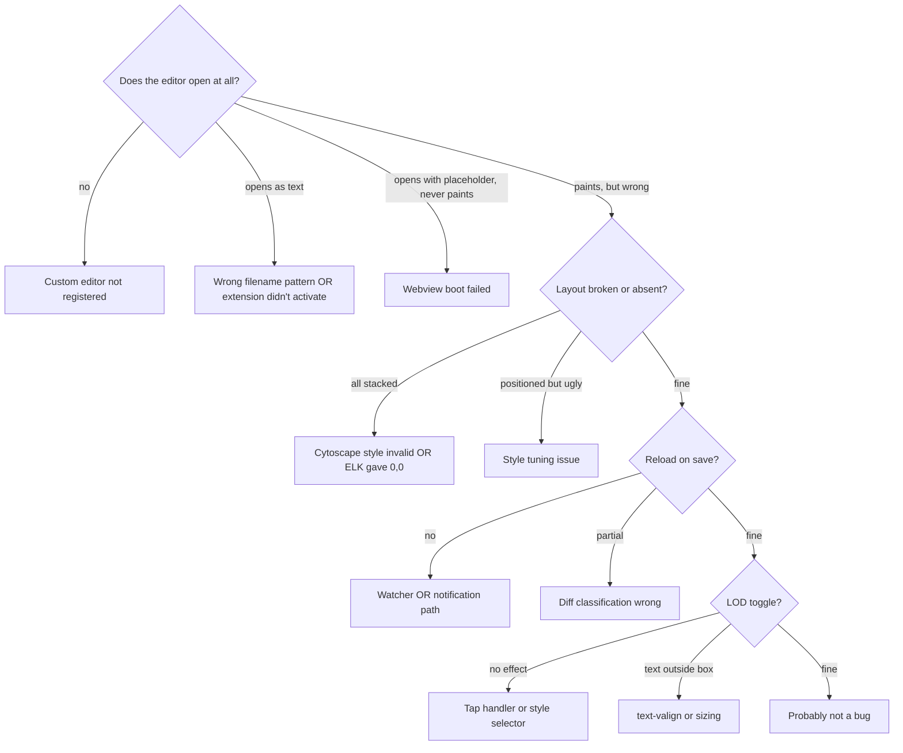

# 3 — Debugging

How to diagnose problems with the viewer. The most common confusion is **which console you're looking at** — this document starts there.

## Table of Contents

1. [Three consoles, three roles](#three-consoles-three-roles) _(Lines 32-50)_
1. [Quick diagnosis decision tree](#quick-diagnosis-decision-tree) _(Lines 53-76)_
1. [Common symptoms](#common-symptoms) _(Lines 79-79)_
   1. [Editor opens as plain text, not as graph](#editor-opens-as-plain-text-not-as-graph) _(Lines 82-85)_
   1. [Extension or `ig-tool` stopped working after moving the repo](#extension-or-ig-tool-stopped-working-after-moving-the-repo) _(Lines 88-103)_
   1. [Webview never paints (stuck on "Loading IntentGraph…")](#webview-never-paints-stuck-on-loading-intentgraph) _(Lines 106-110)_
   1. [All nodes stacked at one point (no layout)](#all-nodes-stacked-at-one-point-no-layout) _(Lines 113-118)_
   1. [Some edges show "Edge X has invalid endpoints"](#some-edges-show-edge-x-has-invalid-endpoints) _(Lines 121-126)_
   1. [Reload on save: nothing happens visually](#reload-on-save-nothing-happens-visually) _(Lines 129-137)_
   1. [Reload runs but graph doesn't visibly update](#reload-runs-but-graph-doesnt-visibly-update) _(Lines 140-142)_
   1. [Structural reload crashes with "webview DOM not ready"](#structural-reload-crashes-with-webview-dom-not-ready) _(Lines 145-147)_
   1. [LOD toggle does nothing visible](#lod-toggle-does-nothing-visible) _(Lines 150-154)_
   1. [Tooltip-style text appears outside the node](#tooltip-style-text-appears-outside-the-node) _(Lines 157-159)_
   1. [`ig-tool found: NO` in earlier dev versions](#ig-tool-found-no-in-earlier-dev-versions) _(Lines 162-166)_
1. [Tracing a message end-to-end](#tracing-a-message-end-to-end) _(Lines 169-215)_
1. [Build problems](#build-problems) _(Lines 218-232)_
1. [Adding diagnostic logs](#adding-diagnostic-logs) _(Lines 235-259)_
1. [What CAN'T be debugged from the CLI](#what-cant-be-debugged-from-the-cli) _(Lines 262-282)_


---

## Three consoles, three roles
<!-- Lines 32-50 -->

You will spend more time chasing the wrong console than fixing actual bugs. The roles:

| Console | Where | Captures | Open with |
| --- | --- | --- | --- |
| **Window (Renderer)** | The **dev host** window itself (Help → Toggle Developer Tools) | VS Code internals, third-party extension noise, the `[Extension Host]`-prefixed lines from VS Code's `console.ts` bridge | Help menu → Toggle Developer Tools, OR `Cmd+Option+I` |
| **Webview** | A separate Chrome DevTools-like window attached to the iframe | The webview bundle's `console.log` (lines beginning with `main.js:NNN`); CSP violations; runtime exceptions in the renderer | Command palette → `Developer: Open Webview Developer Tools` |
| **Debug Console** | Your **main** VS Code window (the one running the F5 debug session) | Direct stdout/stderr from the extension host Node process — the cleanest place to see host-side `console.log` | Bottom panel of the main window → Debug Console tab |

Three things that look the same but aren't:

1. **`[Extension Host] [intentgraph] foo`** in the Window console — this is the host's `console.log` bridged through VS Code's `console.ts`. Same source as Debug Console, just shown in a different place. Both work.
2. **`main.js:124674 [intentgraph] foo`** in the Window console — this is the **webview's** `console.log` *if and only if* the dev host is using the embedded Chromium iframe, which surfaces some webview output in the Window console. Reliable channel: open Webview DevTools explicitly.
3. **`fetch_rag_status rag-status bad status`**, the mermaid `Overwriting extension <<.mmd>>` storm, `vstirbu.vscode-mermaid-preview` errors — all noise from other extensions. Ignore.

If you see neither host-side nor webview-side `[intentgraph]` lines after a save, you are most likely looking at the wrong console.

---

## Quick diagnosis decision tree
<!-- Lines 53-76 -->

Start here for any "it doesn't work" report.



For each leaf, the corresponding section below names the relevant module and the probe to add.

---

## Common symptoms
<!-- Lines 79-79 -->

### Editor opens as plain text, not as graph
<!-- Lines 82-85 -->

- Filename doesn't match a registered selector. Patterns: `*.ig.{json,yaml}`, `*.intentgraph.{json,yaml}`, `*.lens.{json,yaml}`. Rename the file or use `View: Reopen Editor With…`.
- Extension didn't activate. Run `Developer: Show Running Extensions` in the dev host. If `intentgraph.intentgraph-vscode` is missing or errored, the dev session loaded the wrong workspace folder. Check the dev host title bar — should be `[Extension Development Host]`. If F5 launched but loaded a different folder, edit `.vscode/launch.json` `args.--extensionDevelopmentPath`.

### Extension or `ig-tool` stopped working after moving the repo
<!-- Lines 88-103 -->

The install binds two **absolute** paths to this source folder; moving or renaming any parent directory breaks both, silently:

| Binding | Where it lives | Symptom when stale |
| --- | --- | --- |
| Editor symlink | `~/.vscode/extensions/intentgraph.intentgraph-0.0.1` (and Cursor, Insiders, …) | `.ig.yaml` opens as plain text; extension absent from `Developer: Show Running Extensions` |
| `ig-tool` editable install | `~/.local/share/uv/tools/intentgraph-tools/` (`.pth` + `direct_url.json`) | `ig-tool` → `ModuleNotFoundError: No module named 'ig_agents'` |

Fix both in one go from the folder's new location, then reload the window:

```bash
./bootstrap.sh --yes
```

It replaces stale symlinks (never real directories without asking) and reinstalls `ig-tool` if its install points elsewhere. Check with `readlink ~/.vscode/extensions/intentgraph.intentgraph-0.0.1`. If you moved the extension within the repo (not just the repo itself), also check `IG_REPO` at the top of `bootstrap.sh`: it assumes `vscode_extension/intentgraph-vscode/` relative to the repo root and exits with an error if no `intentgraph-tools` `pyproject.toml` is found there.

### Webview never paints (stuck on "Loading IntentGraph…")
<!-- Lines 106-110 -->

- `loadGraph` request silently failed. Open Webview DevTools, look for unhandled rejection or CSP violation.
- The host's `LoadGraphRequest` handler threw. Open Debug Console (main window) — host-side errors land there.
- The graph file is malformed YAML. Run `ig-tool validate -g <path>` from a terminal; non-zero exit means parse will fail.

### All nodes stacked at one point (no layout)
<!-- Lines 113-118 -->

Almost always one of:
1. **ELK 0,0 trap** — a leaf node is missing `width` or `height`. Check `elkBridge.ts buildElkNode`: every non-compound MUST set sentinel `LEAF_WIDTH` and `LEAF_HEIGHT`.
2. **Initial collapse policy too aggressive** — if all visible compounds get collapsed AND none have visible children, Cytoscape can't infer their bounds. The current code has no auto-collapse for this reason; if you reintroduce one, watch this trap.
3. **Cytoscape style is all invalid** — Cytoscape silently skips invalid style values. If you used `var(--vscode-*)` colors anywhere, all those properties are dropped (Cytoscape's canvas engine doesn't expand CSS variables). Check Webview DevTools for `The style property '...' is invalid` warnings.

### Some edges show "Edge X has invalid endpoints"
<!-- Lines 121-126 -->

Endpoints reference UIDs not present in `cy`. Three causes:
1. Source or target was an orphan filtered out at parse time. `loadGraph.ts` keeps only treearc-reachable nodes by default.
2. The intentlink uid string collides with another (multi-edges between same pair). The loader uses a counter suffix to disambiguate; if it didn't, two edges share an `id` and Cytoscape rejects the second.
3. After collapse, expand-collapse should lift the edge to a meta-edge — failure here means the lift logic missed a case.

### Reload on save: nothing happens visually
<!-- Lines 129-137 -->

The chain has four steps; any can fail. Trace in this order:
1. **Watcher fires?** Add `console.log` in `IntentGraphEditorProvider.ts` `scheduleReload`. Check Debug Console.
2. **Notification sent?** Add `console.log` inside the `setTimeout` callback before `messenger.sendNotification(...)`.
3. **Notification received in webview?** Add `console.log` inside `WebviewMessaging.onGraphChanged`. Check Webview DevTools.
4. **Reload runs?** Add `console.log` at the top of `App.handleGraphChanged`.

If step 2 fires but step 3 doesn't, it's the `broadcastMethods` allowlist (see [Architecture §Wire protocol](2_ARCHITECTURE.md#wire-protocol)). Confirm the notification's `method` string is in the array passed to `registerWebviewPanel`.

### Reload runs but graph doesn't visibly update
<!-- Lines 140-142 -->

Most likely the diff was classified as `metadata` and the only field that changed isn't visible at the current LOD (e.g. `intent` text changed but the node is in `lean`, which only shows `name`). Check: add `console.log('classified as:', diff.kind)` in `App.loadAndRender`. If `metadata` for a structural change, the diff function in `state.ts` is wrong. If `metadata` is correct, toggle the affected node to `full` to see the change — or modify a `name` field which `lean` does render.

### Structural reload crashes with "webview DOM not ready"
<!-- Lines 145-147 -->

`#cy` or `#cy-navigator` was removed from the DOM during teardown. The fix lives in `cyMount.ts`: `cy.navigator({ container, removeCustomContainer: false })`. If you remove that flag, the divs get torn down and the next mount fails.

### LOD toggle does nothing visible
<!-- Lines 150-154 -->

- Tap handler not bound. Check `cyMount.ts wireTapLOD` is called from `App.run` after mount.
- Style selector not matching. Check Webview DevTools, inspect `cy` from the console: `cy.nodes().forEach(n => console.log(n.id(), n.data('lod')))`. If `lod` is undefined, `buildElements` isn't writing it.
- `node[lod = "full"]` selector — note the spaces around `=`. Cytoscape's selector parser requires whitespace. Without it, the rule silently doesn't apply.

### Tooltip-style text appears outside the node
<!-- Lines 157-159 -->

`text-valign: 'top'` anchors the label baseline at the node's top edge — multi-line text grows UPWARD off the box. Use `text-valign: 'center'` plus `text-wrap: 'wrap'` plus `text-max-width`. See `cyStyle.ts` `node[lod = "full"]`.

### `ig-tool found: NO` in earlier dev versions
<!-- Lines 162-166 -->

An earlier ping smoke test surfaced this. The current bundle ignores `ig-tool` for normal use (host parses files directly). If you see `ig-tool not found at "..."` in the host log, set `intentgraph.igToolPath` or add `ig-tool` to PATH — but it does not affect the viewer's correctness.

---

## Tracing a message end-to-end
<!-- Lines 169-215 -->

Use this when "the data should be flowing but isn't." Place a probe at every hop:

```ts
// 1. Host: file watcher fires
//    in IntentGraphEditorProvider.ts scheduleReload
console.log('[intentgraph] watcher fired:', uri.fsPath);

// 2. Host: debounce elapsed, sending notification
//    in setTimeout body
console.log('[intentgraph] sending GraphChangedNotification');

// 3. Webview: notification arrives
//    in WebviewMessaging.onGraphChanged callback
console.log('[intentgraph] webview received GraphChangedNotification');

// 4. Webview: handleGraphChanged invoked
//    at the top of App.handleGraphChanged
console.log('[intentgraph] handleGraphChanged');

// 5. Webview: loadGraph request
//    inside loadAndRender after const t0 = ...
console.log('[intentgraph] loadGraph request');

// 6. Host: handler invoked
//    inside the messenger.onRequest(LoadGraphRequestType, ...) body
console.log('[intentgraph] LoadGraph handler');

// 7. Host: parse + return
//    after loadGraph(document.uri) resolves
console.log('[intentgraph] LoadGraph returning, nodes:', model.nodes.size);

// 8. Webview: response received, model rehydrated
//    after rehydrateModel(resp.model)
console.log('[intentgraph] rehydrated, nodes:', next.nodes.size);

// 9. Webview: diff classification
//    after state.diff(next)
console.log('[intentgraph] diff:', diff.kind);
```

Whichever line is the **last** to appear identifies the broken link.

After diagnosis, remove the probes (or at least demote to `console.debug`) before committing.

---

## Build problems
<!-- Lines 218-232 -->

`npm run typecheck` errors usually fall into:

- **Missing types for Cytoscape extensions.** `cytoscape-expand-collapse` ships no `.d.ts`. The project has a shim at `src/shared/shims.d.ts` (`declare module 'cytoscape-expand-collapse';`). Other unfamiliar extensions need similar entries.
- **`Stylesheet` not exported.** Cytoscape exports `StylesheetStyle` and `StylesheetCSS` (different shape — `style` vs `css` prop); `Stylesheet` is a union type only available via `cytoscape.Stylesheet` after a namespace import. Use `cytoscape.StylesheetStyle[]` for our codebase (we use the `style:` shape).
- **`PopperFactory` mismatch.** We don't use popper anymore; if you reintroduce it, note the `popperFactory(ref, popperOpts)` calling convention.

`npm run compile` problems usually mean a missing dependency in `package.json` or a TypeScript file that imports from a path TS can resolve but esbuild can't.

If `dist/webview/main.js` is unexpectedly small (< 100 KB), the webview entry point did not pull in cytoscape and elkjs. Check `webview/main.ts` imports — it should transitively bring in `webview/cyMount.ts` which imports `cytoscape` and registers plugins.

`grep -c tippy dist/webview/main.js` should be 0 (tippy was removed). If it's nonzero, you reintroduced an import.

---

## Adding diagnostic logs
<!-- Lines 235-259 -->

A minimal probe that doesn't break typecheck or lint:

```ts
// eslint-disable-next-line no-console
console.log('[intentgraph] <where>:', <what>);
```

Conventions used during development:
- Prefix with `[intentgraph]` so log lines are greppable.
- Use the host module name or webview action name as the `<where>` tag.
- Keep payloads small — long objects clutter the console.
- Remove probes before committing; if you want a permanent log, demote to `console.debug` and gate behind `intentgraph.logPerf` (a settings hook reserved but currently unused).

For data-shape inspection, prefer `JSON.stringify(obj, null, 2)` only for small objects. For Maps, `Array.from(map.entries())`.

The Webview DevTools console accepts live evaluation. While paused, you can run things like:
```js
cy.nodes().length
cy.nodes('node[lod = "full"]').length
cy.$id('PIG-PY.STRUCT.PKG').data()
```

---

## What CAN'T be debugged from the CLI
<!-- Lines 262-282 -->

These require the F5 dev host:

- Custom editor activation (`onCustomEditor:intentgraph.graphViewer`).
- `vscode.window.createStatusBarItem` visibility logic.
- The webview's CSP enforcement (CSP violations only show in real Chromium, not `node --check`).
- `vscode.WebviewPanel` lifecycle events (`onDidChangeViewState`, `onDidDispose`).
- File watcher behavior on the actual filesystem.
- `acquireVsCodeApi()` — only available inside a real webview.
- Anything that depends on user gesture or focus state.

Static checks that DO work from the CLI:

- `npm run typecheck` — TypeScript strict.
- `npm run compile` — esbuild bundle.
- `node --check dist/extension.js` — syntax check on the cjs bundle.
- `node --check dist/webview/main.js` — same on the iife bundle.
- `grep`-based audits (banned packages, banned patterns).
- Standalone runs of `loadGraph` or `buildElkJson` from a `node -e` shim, with the `vscode` import stubbed.

Tester subagents in Waves 1–3 used these CLI checks for everything verifiable, then deferred runtime validation to a manual F5.
